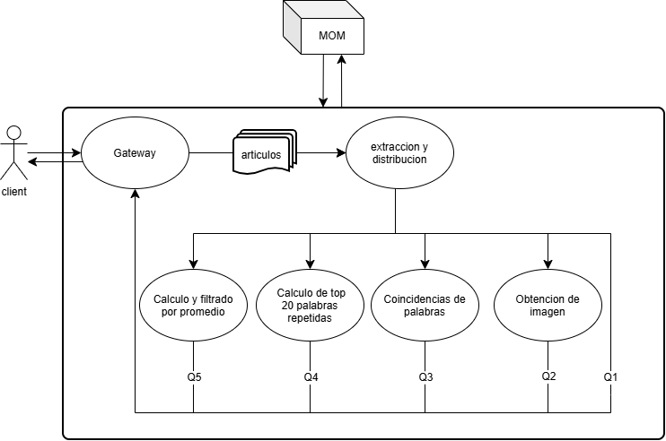
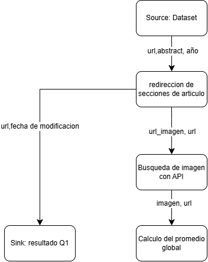
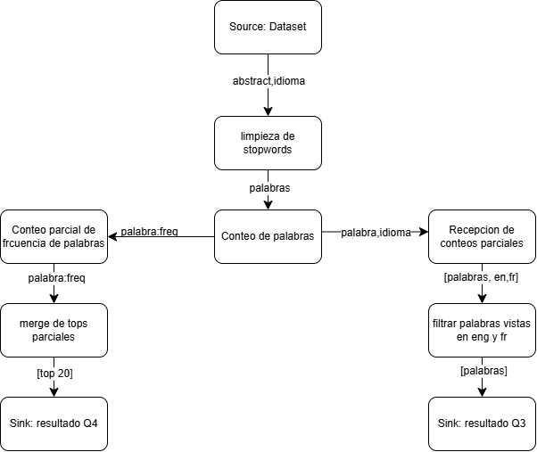
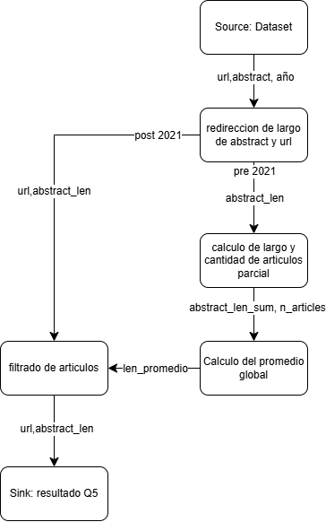
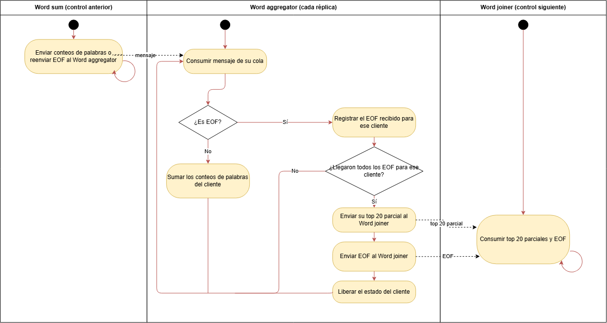
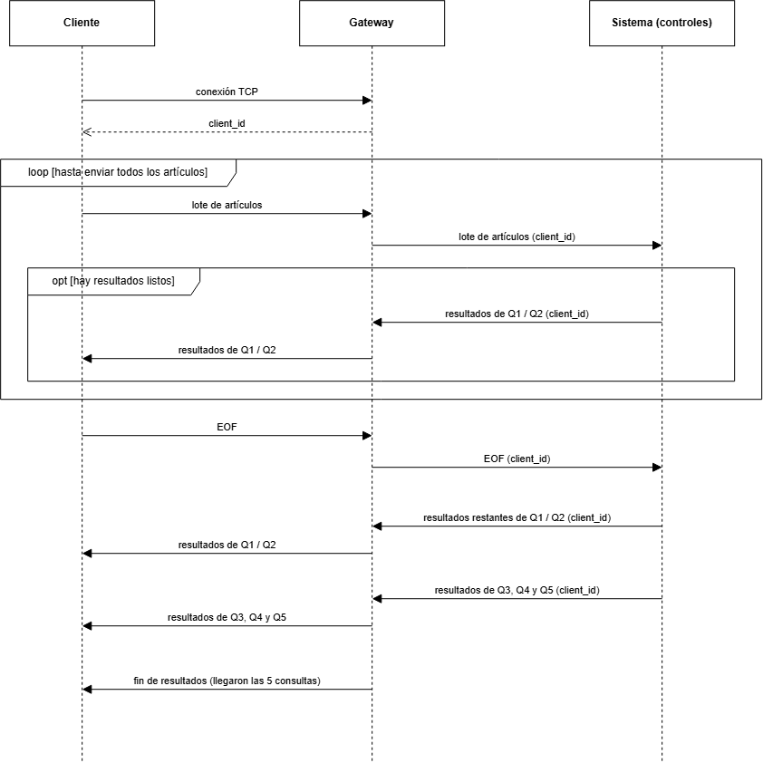
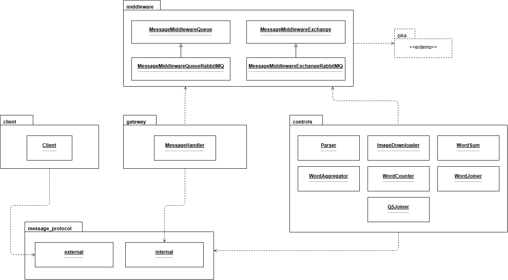
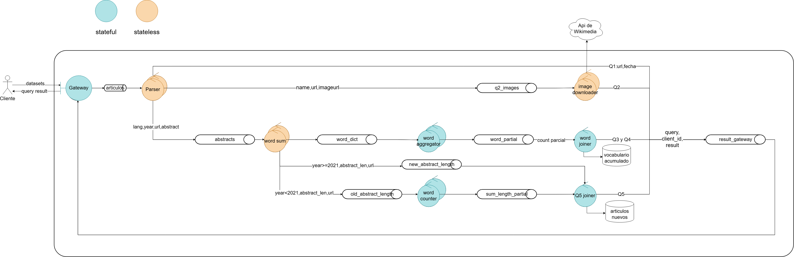
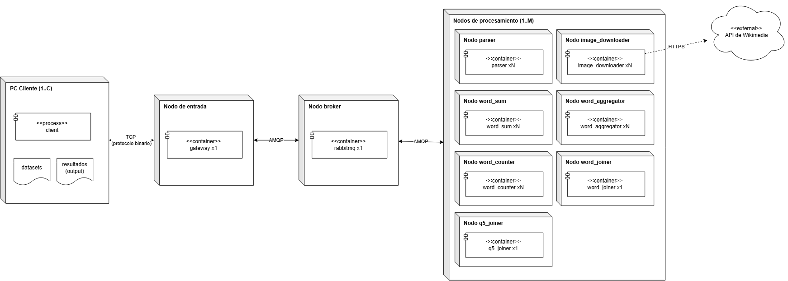

# Documento de Arquitectura – Wikipedia Article Analysis
**Sistemas Distribuidos I (75.74) – TP Grupal, Diseño**

**Grupo 21**:
Integrantes: Santiago Corrado, Lucca Marino

Este documento sigue el modelo 4+1 Views. Describe el sistema desde distintos puntos de vista.

## Índice

1. [Alcance](#1-alcance)
2. [Arquitectura de software](#2-arquitectura-de-software)
3. [Objetivos y restricciones](#3-objetivos-y-restricciones)
4. [Vista lógica](#4-vista-lógica)
5. [Vista de procesos](#5-vista-de-procesos)
6. [Vista de desarrollo](#6-vista-de-desarrollo)
7. [Vista física](#7-vista-física)
8. [Tamaño y rendimiento](#8-tamaño-y-rendimiento)
9. [Tareas y división entre integrantes](#9-tareas-y-división-entre-integrantes)

## 1. Alcance

El sistema analiza artículos de Wikipedia (en inglés y en francés) que un cliente le envía, y le devuelve el resultado de 5 consultas. El procesamiento se reparte entre varios procesos (controles) que trabajan en paralelo y se comunican con un MOM.

## 2. Arquitectura de alto nivel

El sistema es un pipeline: los datos entran por un único punto (Gateway), pasan por una cadena de controles conectados por colas y los resultados vuelven por el mismo punto. Cada mensaje lleva el `client_id` del cliente que lo originó de forma que varios clientes pueden usar el sistema a la vez y los controles saben en todo momento a quien corresponde cada dato y resultado, para poder devolver las consultas al cliente correcto.

## 3. Objetivos y restricciones

**Objetivos**
- Que el sistema escale al aumentar los clientes, el volumen de datos y la cantidad de réplicas.
- Que cliente y sistema trabajen en streaming: se procesa y se responde a medida que llegan los datos, sin cargar todo en memoria.

**Restricciones**
- Se comunica mediante colas y exchanges de RabbitMQ, con un middleware propio que oculte esa comunicación al resto del código.
- No se permiten **sleep** para sincronizar o **spin locks** para poolear.
- Al menos la mitad de los tipos de control deben poder replicarse.
- El sistema se despliega con `docker-compose`.
- Cierre ordenado de cada proceso cuando se le indica que debe terminar.

## 4. Vista lógica

Funcionalidad del sistema: mostramos cómo se transforman los datos hasta llegar a cada resultado. Utilizamos diagramas DAG para esto:

### 4.1 DAG de Q1 y Q2 (imagen y url)

Se extrae la fecha, url y url de imagen de cada articulo para responder las querys Q1 (articulos anteriores a 2021) y Q2 (articulos anteriores a 2021 e idioma del articulo debe ser ingles).

### 4.2 Conteo de palabras por idioma (Q3 y Q4)

El abstract de cada artículo se limpia (se sacan las stopwords) y se cuentan sus palabras por idioma. Esos conteos parciales se suman entre todos los artículos y se obtienen las 20 palabras más usadas (Q4) y las palabras que aparecen en inglés y en francés (Q3).

### 4.3 Cálculo del promedio y filtrado por largo de abstract (Q5)

Los artículos anteriores a 2021 se usan para calcular el promedio global del largo de abstract. Los artículos de 2021 en adelante esperan a conocer ese promedio y recién entonces se filtran.

## 5. Vista de procesos

Aquí mostramos cómo se comporta el sistema mientras corre: qué pasa y en qué orden.

### 5.1 Detección del fin de los datos de un cliente

Como los datos de un cliente se reparten entre varias réplicas, hay que saber cuándo se terminaron todos. Lo mostramos con el `Word aggregator`, que es stateful: recibe los conteos de los `Word sum` y envía al `Word joiner`. El `Word sum`, al ser stateless, no espera a que terminen los `Parser`: envía los conteos de cada lote apenas los calcula y, cada vez que le llega el mensaje de fin (EOF) de un `Parser`, lo reenvía a cada réplica de `Word aggregator`. Cada réplica lo recibe por su propia cola, detrás de los datos, y registra los EOF que llegaron para ese cliente. Cuando llegaron todos (uno por cada par `Parser`–`Word sum`), envía su top 20 parcial y un EOF al `Word joiner`, y libera el estado de ese cliente. El resto de los controles stateful siguen el mismo esquema, cambiando el mecanismo de envío según la tabla de la sección 7.1.

### 5.2 Interacción entre el cliente y el sistema

El diagrama cómo se comunica un cliente con el sistema y en qué momento recibe cada resultado. Al conectarse, el `Gateway` le asigna un `client_id`, que acompaña a todos sus mensajes dentro del sistema. El cliente envía los artículos en lotes y el `Gateway` los reenvía al sistema. Mientras el cliente sigue enviando, ya pueden volver resultados de Q1 y Q2, porque se resuelven artículo por artículo. Cuando el cliente termina, envía un EOF, que el `Gateway` propaga al sistema. Después de eso se completan los resultados de Q1 y Q2, y llegan los de Q3, Q4 y Q5, que necesitan todos los datos para calcularse. Cuando llegaron las 5 consultas, el `Gateway` le avisa al cliente que terminó.

## 6. Vista de desarrollo

En esta vista mostramos cómo se organiza le código.

### 6.1 Organización del código en módulos 

- **`client` y `gateway`** son las dos aplicaciones de entrada y salida.
- **`controls`** agrupa los 7 controles restantes. Cada uno es una aplicación con su propio `Dockerfile`.
- **`middleware`** oculta RabbitMQ. Sus clases definen cómo se envía y recibe de una cola o de un exchange.
- **`message_protocol`** define el formato de los mensajes: `external` (entre cliente y gateway) e `internal` (entre controles).

## 7. Vista física

Esta vista describe las conexiones físicas entre los componentes y qué corre dónde.

### 7.1 Controles del sistema y sus conexiones

Muestra los controles, las colas entre ellos y el camino de cada consulta.

### Controles del sistema:

| Control | Función | Réplicas | Estado |
|---|---|---|---|
| **Gateway** | Recibe los datos del cliente y le devuelve los resultados | 1 | Mantiene el estado de las conexiones con los clientes |
| **Parser** | Lee cada artículo, lo clasifica y lo reparte según la consulta | varias | Ninguno |
| **Image downloader** | Descarga las imágenes de Wikimedia (Q2) | varias | Ninguno |
| **Word sum** | Cuenta las palabras de cada abstract (Q3, Q4) y envía los largos de abstract (Q5) | varias | Ninguno |
| **Word aggregator** | Suma los conteos de palabras de todos los word sum | varias | se almacenan en la memoria RAM los conteos de palabras y registros de EOF |
| **Word joiner** | Une los resultados parciales y arma Q3 y Q4 | 1 | Se mantienen en un storage las sumas parciales de los aggregators hasta obtener todos los conteos parciales de los aggregator |
| **Word counter** | Suma los largos de los abstracts viejos, para el promedio de Q5 | varias |se almacenan en la memoria RAM la suma de los largos de abstracts y registros de EOF |
| **Q5 joiner** | Calcula el promedio y decide qué artículos nuevos cumplen Q5 | 1 | Se mantienen en RAM las sumas parciales de los largos y se almacena la informacion de los articulos a ser filtrados una vez obtenido el promedio|

### Comunicación entre controles

 La siguiente tabla resume los mecanismos utilizados para cada comunicación entre las entidades del sistema.

| Emisor | Receptor | Mecanismo de comunicación |
|---|---|---|
| Cliente | Gateway | TCP |
| Gateway | Parsers | Colas de RabbitMQ, con una cola entre el Gateway y cada parser. |
| Parsers | Word_sums | Exchange de RabbitMQ, al que cada instancia de word_sum se suscribe mediante una routing key que la representa. |
| Parsers | Image_downloaders | Exchange de RabbitMQ, al que cada instancia de Image_downloader se suscribe mediante una routing key que la representa |
| Word_sums | Word_aggregator | Exchange de RabbitMQ, al que cada instancia de Word_aggregator se suscribe mediante una routing key que la representa. |
| Word_aggregator | Word_joiner | Cola compartida de RabbitMQ, a la que publican los emisores y desde la que consume el receptor. |
| Word_sums | Word_counter | Exchange de RabbitMQ, al que cada instancia de Word_counter se suscribe mediante una routing key que la representa |
| Word_sums | Q5Joiner | Cola compartida de RabbitMQ, a la que publican los emisores y desde la que consume el receptor. |
| Word_counter | Q5Joiner | Cola compartida de RabbitMQ, a la que publican los emisores y desde la que consume el receptor. |
| Worker | Gateway | Cola compartida de RabbitMQ, a la que publican los emisores y desde la que consume el receptor. |

### 7.2 Distribución de los procesos en nodos

(xN: cantidad de réplicas, configurable en docker-compose)

Cada control corre en su propio contenedor Docker. Los contenedores solo se comunican entre sí a través de RabbitMQ, por lo que pueden repartirse en distintas máquinas sin cambiar nada. El cliente se conecta al Gateway por TCP, y el `image downloader` es el único que sale a la API de Wikimedia. 

## 8. Tamaño y rendimiento

Cómo escala el sistema:

- **Cantidad de clientes:** todos usan las mismas colas y el `client_id` mantiene separados sus datos. Cada control guarda su estado por cliente y lo libera cuando ese cliente termina.
- **Cantidad de datos:** los datos se procesan de a lotes y cada etapa reduce lo que pasa a la siguiente. Por ejemplo, el `word sum` envía conteos de palabras y no los abstracts completos, y cada `word aggregator` envía al `word joiner` solo su top 20, evitando que algún proceso necesite cargar todo en memoria.
- **Cantidad de réplicas:** A mayor cantidad de réplicas, mayor distribución del procesamiento en cada etapa, a costa de mayor cantidad de mensajes para coordinar el fin de cada estapa. 

## 9. Tareas y división entre integrantes

La división busca que cada integrante tenga un área propia, con pocas dependencias entre sí.

| Integrante | Área | Paquetes |
|---|---|---|
| Facundo | Comunicación y entrada/salida | `middleware`, `message_protocol`, `gateway`, `client` |
| Santiago | Parser, imágenes y Q5 | `Parser`, `Image downloader`, `Word counter`, `Q5 joiner` |
| Lucca | Palabras y validación | `Word sum`, `Word aggregator`, `Word joiner`, automatizar comparación con la ejecución serial, `docker-compose` |
